# HyperHive UI proposal catalogue

Review of the local HyperHive desktop web UI on 27 October 2026. Proposals only: no application implementation or infrastructure operations were performed. Select individual items and send the resulting IDs in chat; selecting a checkbox does not authorize or apply a change. Nothing is preselected.

Evidence: real browser screenshots and accessibility-tree observations, plus stored design preferences. Observed means the current view supports the finding; Optional means a design choice; Verify first means behavior/data needs inspection before any fix. Loading views do not prove a persistent failure. P1 = address first, P2 = usability improvement, P3 = optional expansion. S/M/L are relative implementation scope, not time estimates.

Preserve: VM status-colored borders, host-grouped cards and compact allocation summaries; neutral VM companion borders; row-based backups; automatic refresh without interval labels. No blanket density change is approved. Reuse the current typography, teal palette, Lucide and house components.

Limits: desktop dark/system appearance only. No exhaustive keyboard/screen-reader, phone, zoom, light-theme, error-state or populated-state certification. Login/logout, noVNC, GoAccess, StreamInfo and unused demo routes were not exercised. No create/save/delete/power/update/permission action was submitted. Screenshots include private infrastructure names and paths; keep this report local.

100 individual proposals across 38 review sections. All unchecked.

## Shared shell and design language — All pages

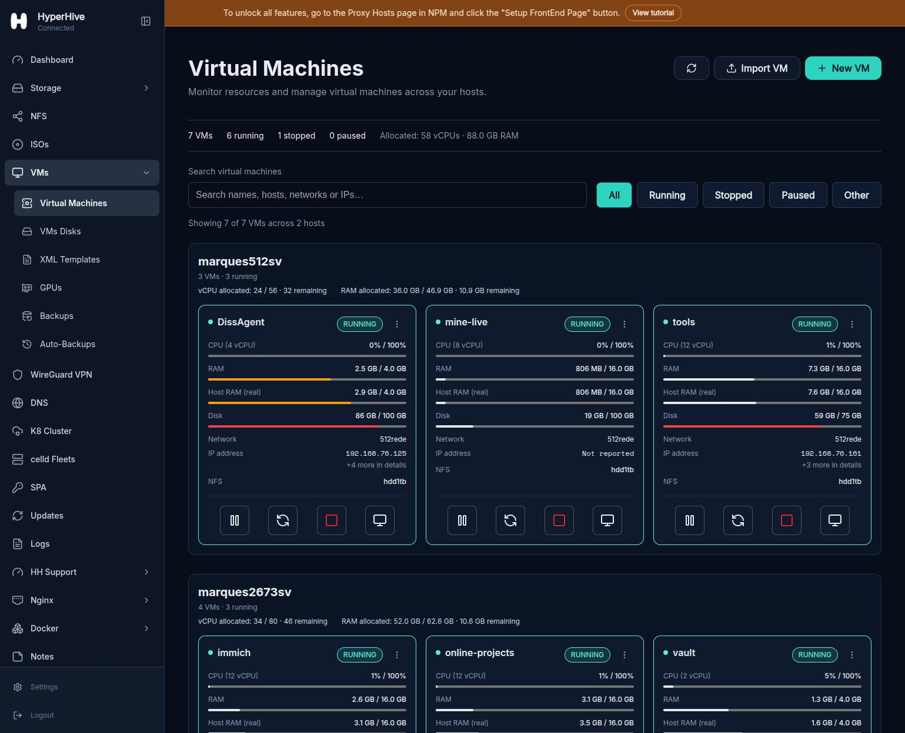

Keep the current dark/teal direction, Lucide icons and existing components. No font or dependency replacement is needed.

- [ ] **G01 · P1 · M · Observed — Reserve space below the setup banner**

  Docker and Notes headings touch the banner; use one shared content offset and consistent top spacing on every route.

- [ ] **G02 · P2 · M · Optional — Turn the permanent setup strip into a setup notice**

  Offer a direct setup destination, explain the affected feature, and allow dismissal after acknowledgement. Preserve the underlying setup requirement.

- [ ] **G03 · P2 · M · Observed — Align page gutters and headers**

  Standardize title, subtitle, action row and content start. Current left gutters vary substantially between DNS, VMs, Support, Logs and Docker.

- [ ] **G04 · P2 · S · Observed — Use one primary button treatment**

  Teal and white both mean primary today. Keep the current teal brand and define consistent primary, secondary, quiet and danger variants.

- [ ] **G05 · P2 · S · Observed — Unify filters and status badges**

  NFS selected filters, XML counters and Nginx chips use different treatments. Use a consistent selected state and restrained status tokens.

- [ ] **G06 · P1 · M · Observed — Give every control an accessible name**

  NFS, backups, DNS, VPN, Docker and Nginx contain unnamed buttons in the accessibility tree; several inputs are named only Input Field. Include the resource name in repeated actions.

- [ ] **G07 · P1 · M · Observed — Distinguish pending data from zero**

  Dashboard, Docker, Updates and Nginx initially show zeros or empty content before data arrives. Use unknown placeholders/skeletons until the first response.

- [ ] **G08 · P2 · M · Optional — Make secondary text and badges easier to read**

  Several metadata lines and dark chips appear faint. Measure text at 4.5:1 and essential controls at 3:1 before changing tokens; this audit does not certify contrast ratios.

- [ ] **G09 · P2 · M · Optional — Add searchable navigation**

  The expanded menu requires long scrolling. Add a small navigation search, preserving the existing resize and collapse behavior.

- [ ] **G10 · P2 · M · Optional — Use explicit resource names and consistent terminology**

  Prefer Host over Slave in interface copy, VM disks over VMs Disks, and Kubernetes over K8 Cluster. Keep API identifiers unchanged.

- [ ] **G11 · P1 · M · Verify first — Check shared modal keyboard behavior**

  Audit dialog semantics, named close controls, Escape, focus containment and focus return. The observed trees expose backgrounds and unnamed close buttons; a full screen-reader test remains needed.

- [ ] **G12 · P2 · M · Optional — Standardize dates and technical values**

  Use one date/time format with timezone for schedules, tabular numbers, and monospace for addresses/paths. Preserve exact technical strings and allow copying full values.

- [ ] **G13 · P2 · M · Verify first — Complete phone, zoom and keyboard checks**

  Check 375px, tablet, landscape, 200% zoom, reduced motion, light theme and keyboard focus before rolling out shared changes. These are validation work, not confirmed defects.

## Cluster Dashboard — /dashboard

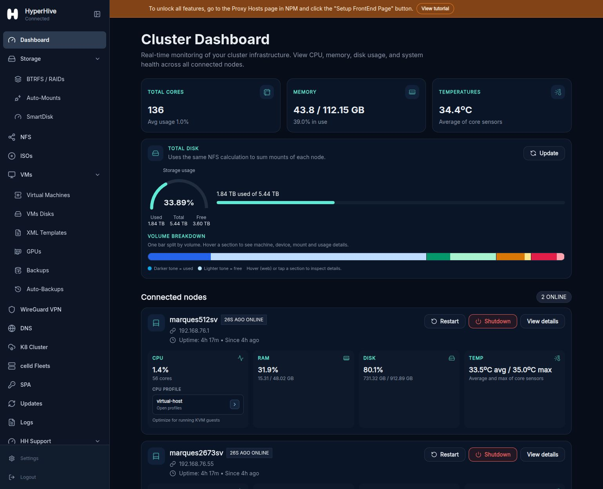

- [ ] **D01 · P2 · M · Observed — Replace redundant storage graphics with one clear comparison**

  The gauge, total bar and volume strip repeat capacity information. Keep a compact total, then show labeled per-volume used/free bars with host and mount names.

- [ ] **D02 · P2 · S · Observed — Replace implementation copy with operator copy**

  Replace Uses the same NFS calculation with a plain description of included mounts. Label the Update button Refresh storage so its scope is clear.

- [ ] **D03 · P2 · M · Optional — Surface attention items before normal telemetry**

  Add a compact attention summary linking to high storage usage, unhealthy disks and stale hosts, using already available data. Requires agreed thresholds; no new monitoring backend assumed.

## Host details — /dashboard/[machine]

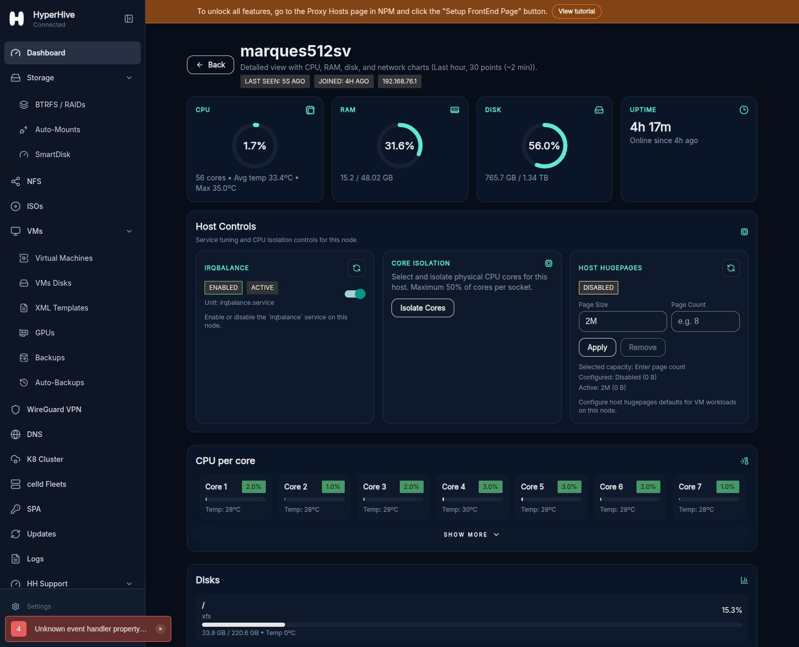

The warning toast in this screenshot belongs to the development runtime; it is not evidence of a production warning.

- [ ] **H01 · P2 · M · Observed — Move tuning controls behind a distinct section**

  Host Controls occupies a large area before disk/network/history diagnostics. Put monitoring first and keep service tuning in an expandable Advanced controls section.

- [ ] **H02 · P2 · S · Observed — Make hugepage state understandable**

  Group configured versus active capacity together and explain what zero active capacity means; avoid requiring operators to reconcile Disabled with Active: 2M (0 B). Verify backend meanings first.

- [ ] **H03 · P2 · M · Optional — Reduce repeated gauges and tall empty panels**

  Use compact metrics and align host-control content to its actual height. Keep per-core detail available, with a clear expanded state.

## Btrfs RAIDs — /btrfs-raids

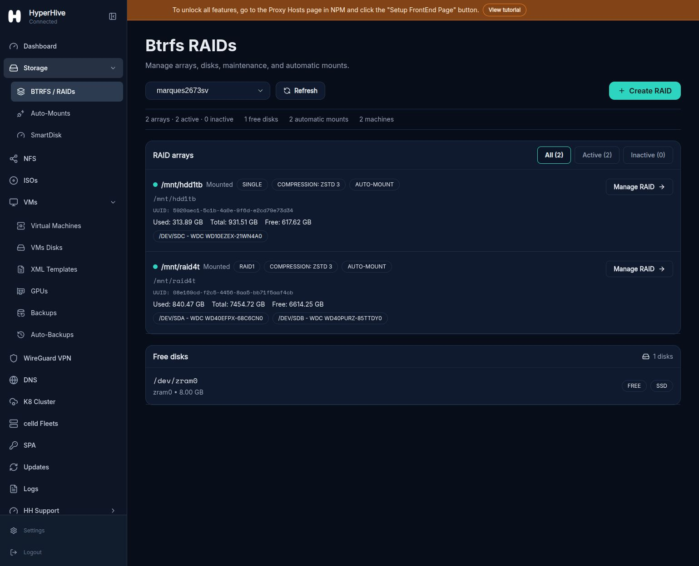

- [ ] **BR01 · P1 · M · Verify first — Verify eligibility of devices shown as free disks**

  The list shows /dev/zram0 as a free SSD. Check whether it is actually eligible for array creation; if not, exclude it or explain why it cannot be used. This is not proof that creation accepts it.

- [ ] **BR02 · P2 · S · Observed — Make capacity and identity easier to scan**

  Add a small labeled usage bar, align used/total/free values, and make UUID secondary but copyable. Preserve the existing balanced density.

## Automatic mounts — /btrfs-automatic-mounts

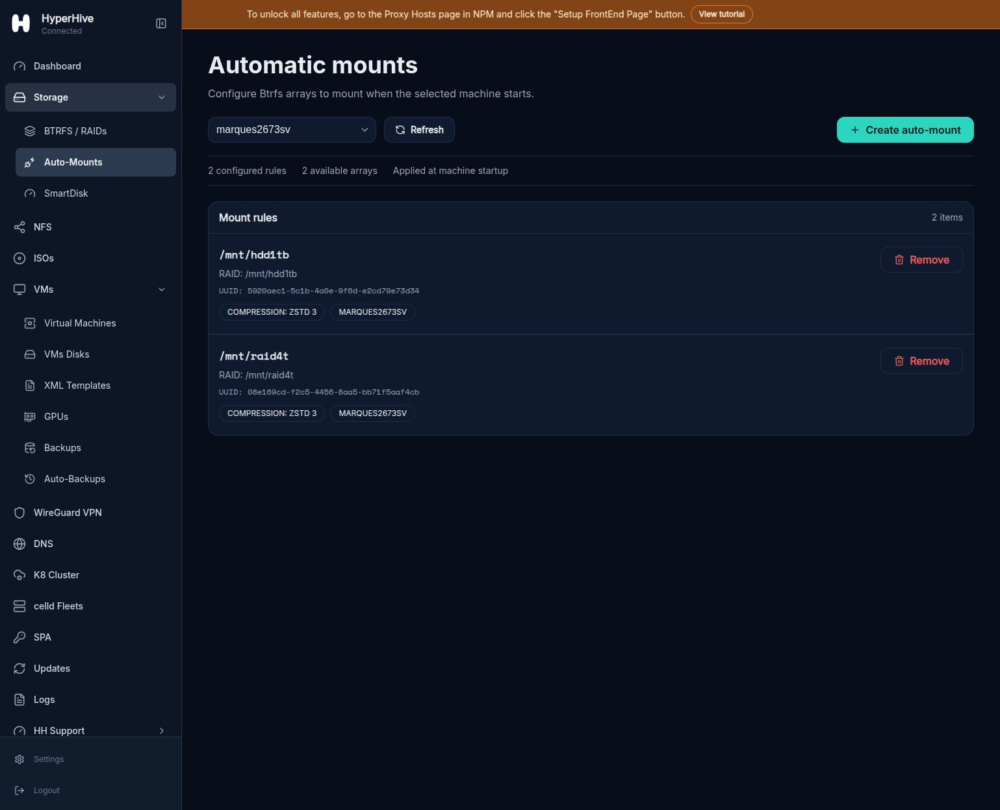

- [ ] **AM01 · P2 · S · Observed — Clarify removal scope**

  Rename Remove to Remove rule and explain that removing the startup rule differs from unmounting the active filesystem. Verify existing behavior before final copy.

- [ ] **AM02 · P3 · S · Optional — Trim repeated row metadata**

  Keep mount path, array and compression aligned; move repeated host/UUID detail to a disclosure with copy support.

## Smart Disk — /smartdisk

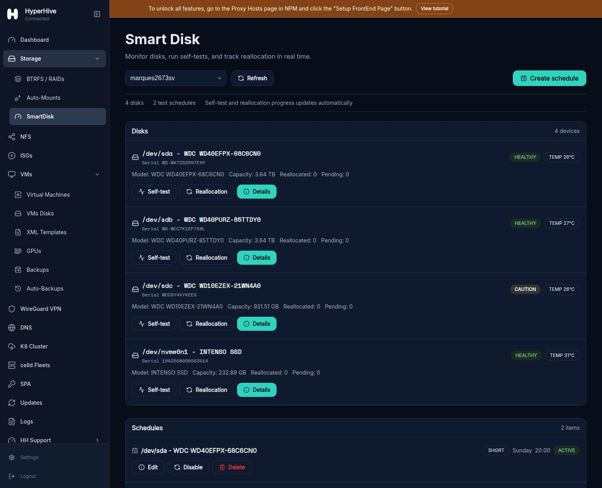

- [ ] **SD01 · P1 · M · Observed — Explain Caution beside the disk**

  The caution disk shows zero reallocated and pending sectors, so the reason is unclear. Show the actual triggering attribute and a View health details action; do not infer failure from the badge alone.

- [ ] **SD02 · P2 · S · Observed — Clarify reallocation and action hierarchy**

  Details is repeated as a primary teal action while Reallocation is unexplained. Keep Details neutral and explain potentially intensive maintenance before its confirmation.

- [ ] **SD03 · P2 · M · Optional — Add health filtering and next-run context**

  Allow attention-only filtering, and show the next scheduled test with timezone. Next-run display may require derived scheduling logic or an API field.

## NFS mounts — /mounts

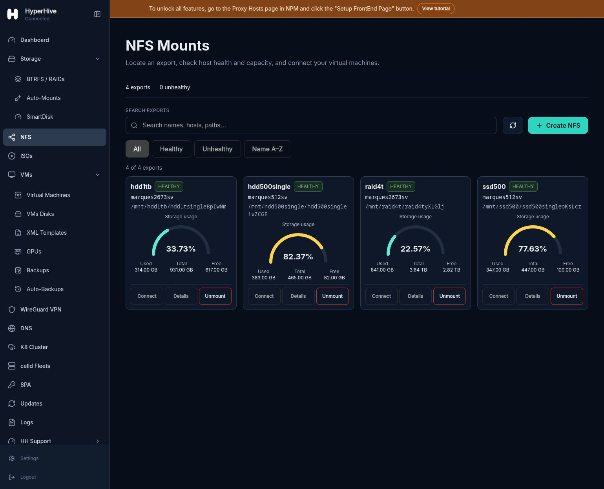

- [ ] **NF01 · P2 · M · Optional — Offer compact capacity rows**

  Replace or supplement large gauges with name, host, path, used/free and VM connection counts in aligned rows. This is a density choice; retain cards if preferred.

- [ ] **NF02 · P1 · S · Observed — Separate unmount from routine actions**

  Unmount sits directly beside Connect and Details on every card. Move it to a clearly labeled danger area or menu and explain affected consumers at confirmation.

- [ ] **NF03 · P2 · S · Observed — Keep full paths inspectable**

  Long export paths wrap inside narrow cards. Provide full-value disclosure and a labeled copy button without expanding every row.

## ISO library — /isos

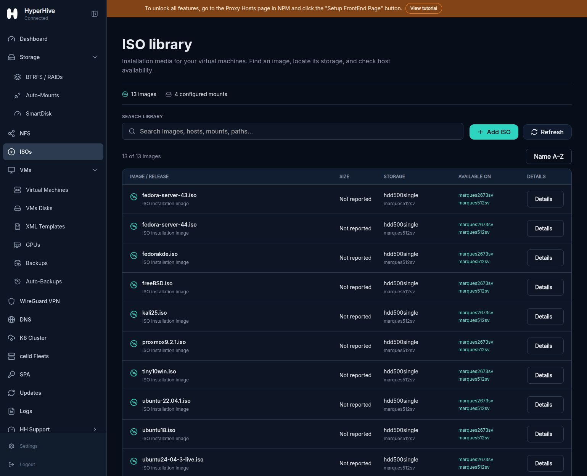

The current row layout and explicit host availability are good foundations; a full redesign is unnecessary.

- [ ] **IS01 · P2 · S · Observed — Explain unavailable sizes once**

  Every visible size says Not reported. Use an unknown marker with a column-level explanation, or show sizes only when supplied; do not imply zero bytes.

- [ ] **IS02 · P3 · M · Optional — Add storage and host filters**

  Search already works across the library; optional dropdown filters make storage placement and host availability easier to browse as inventory grows.

## Virtual Machines — /vms

- [ ] **VM01 · P2 · M · Optional — Explain the two RAM measurements**

  Rename RAM and Host RAM (real) only after confirming their semantics, and add short help explaining why they differ. Keep both readings available.

- [ ] **VM02 · P2 · S · Observed — Make power actions recognizable before clicking**

  The actions have accessible names but no visible labels. Add keyboard-accessible tooltips or short labels for pause, restart, shutdown and details; retain frequently used actions.

- [ ] **VM03 · P3 · M · Optional — Offer a compact row view for larger fleets**

  Add an optional view with host grouping, state, CPU/RAM/disk, primary IP and actions. Preserve the current cards, colored borders and compact host allocation summaries.

## VM creation — New VM dialog

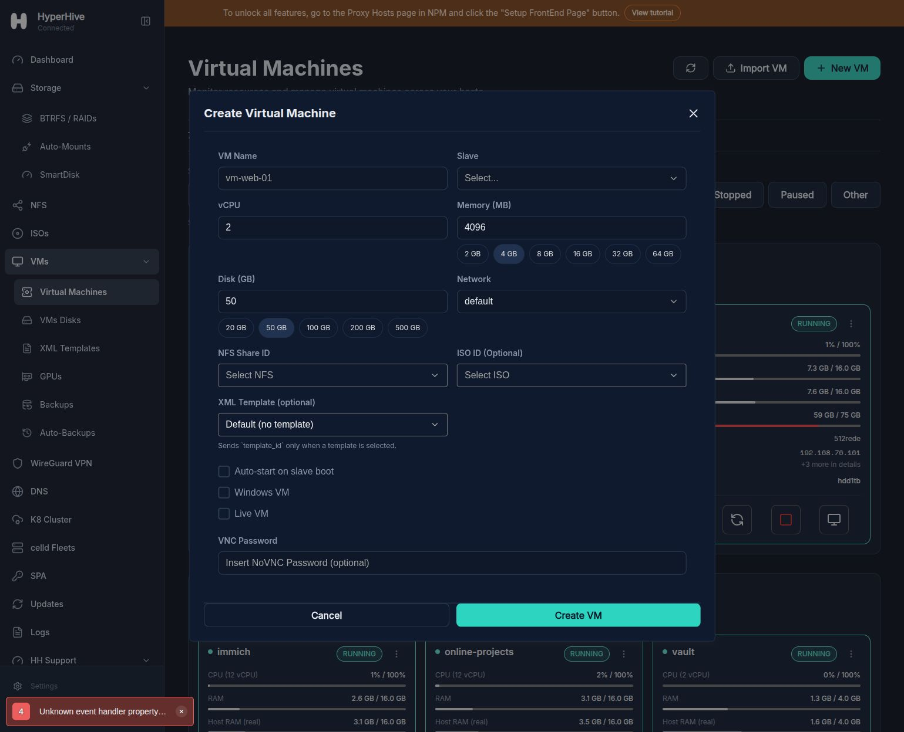

Form opened and cancelled without submission. Validation, live creation and failure recovery were not exercised.

- [ ] **VC01 · P2 · M · Observed — Group basic and advanced options**

  Group identity/host, resources, storage and network. Put XML template and specialized flags in Advanced while keeping selected values visible in a review summary.

- [ ] **VC02 · P2 · S · Observed — Replace API-facing form language**

  Use Host, NFS share and Installation ISO. Remove Sends template_id only when a template is selected and explain the actual effect of selecting a template.

- [ ] **VC03 · P1 · M · Observed — Associate labels and expose preset buttons correctly**

  Inputs appear as Input Field and RAM/disk presets as containers in the accessibility tree. Give inputs meaningful names and presets button roles with selected state.

- [ ] **VC04 · P2 · M · Optional — Show host and storage capacity before creation**

  Once host and NFS are selected, show available capacity and explain overcommit warnings. Reuse allocation semantics and avoid silently changing creation rules.

## VM details — VM details dialog

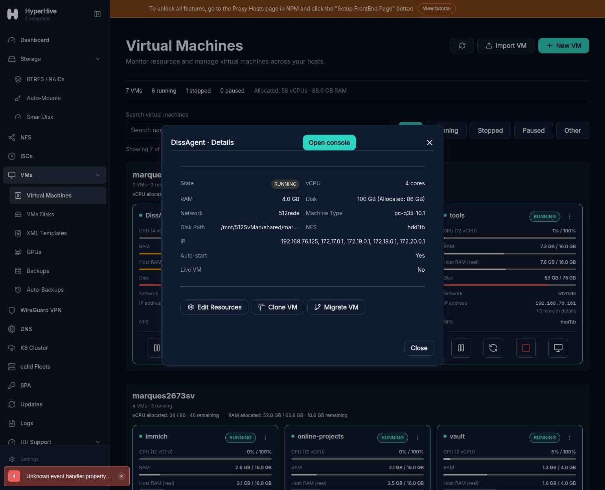

- [ ] **VD01 · P2 · S · Observed — Allow full path and per-interface IP inspection**

  Disk Path is truncated and all IPs share one line. Wrap or disclose the full path with copy, and list addresses individually with interface context when available.

- [ ] **VD02 · P3 · L · Optional — Give VM details a dedicated URL**

  Make details shareable and preserve browser Back, keeping a lightweight modal for quick inspection if useful. This changes navigation and needs route/state work.

## VM disks — /vms-disks

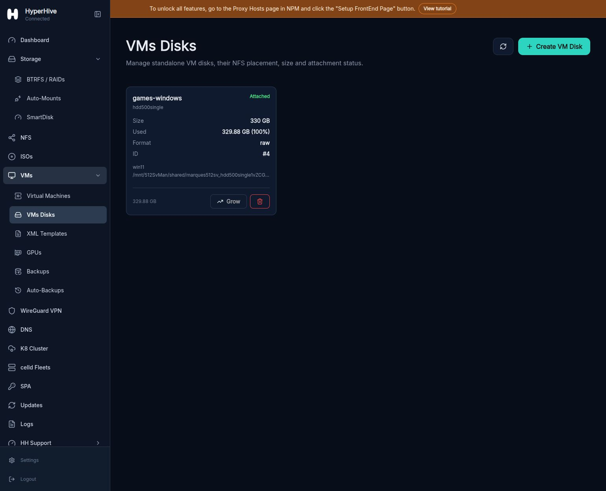

- [ ] **DK01 · P1 · M · Verify first — Clarify what Used measures for raw disks**

  The attached raw disk reads 100%. Verify whether this is host allocation rather than guest filesystem usage and label it accordingly to avoid a false full-disk interpretation.

- [ ] **DK02 · P2 · S · Observed — Show attachment and path more clearly**

  Give attached VM its own labeled field, disclose/copy the full path, and separate deletion from Grow. Keep attached-resource safety in the existing backend.

## XML templates — /vms-xml-templates

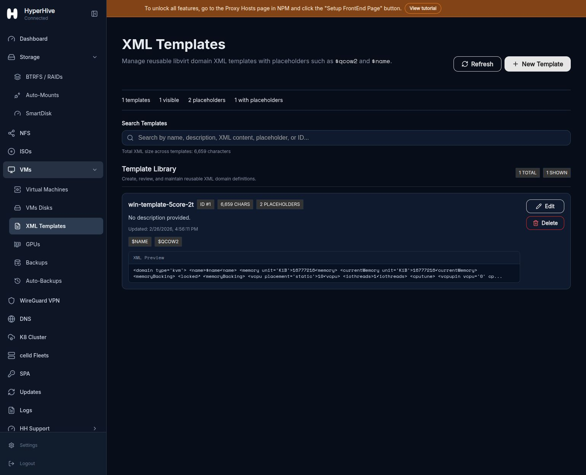

- [ ] **XT01 · P2 · S · Observed — Remove repeated counts and character totals**

  The same one-template count appears in multiple summaries; character counts dominate the page. Keep total/matching count once and show size only in detail.

- [ ] **XT02 · P2 · M · Observed — Make XML preview readable on demand**

  Use a collapsible formatted code preview instead of a flattened truncated line. Preserve placeholder case exactly and make placeholder behavior available in help.

## GPUs — /gpus

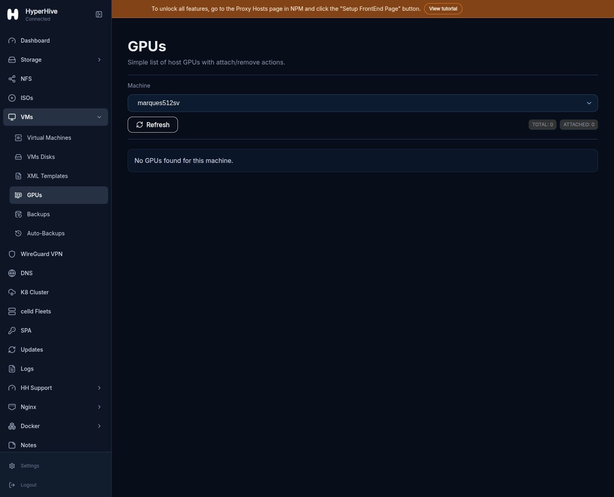

Only the empty inventory for the selected host was verified; populated GPU assignment is outside this pass.

- [ ] **GP01 · P2 · S · Observed — Use a compact host selector toolbar**

  The host selector spans the page while Refresh and counters occupy another row. Match the compact toolbar used by other storage pages.

- [ ] **GP02 · P2 · S · Optional — Explain the empty inventory state**

  Explain whether no devices were detected versus none eligible for passthrough, and provide Retry and a host-switch suggestion only where the API can distinguish those cases.

## Backups — /backups

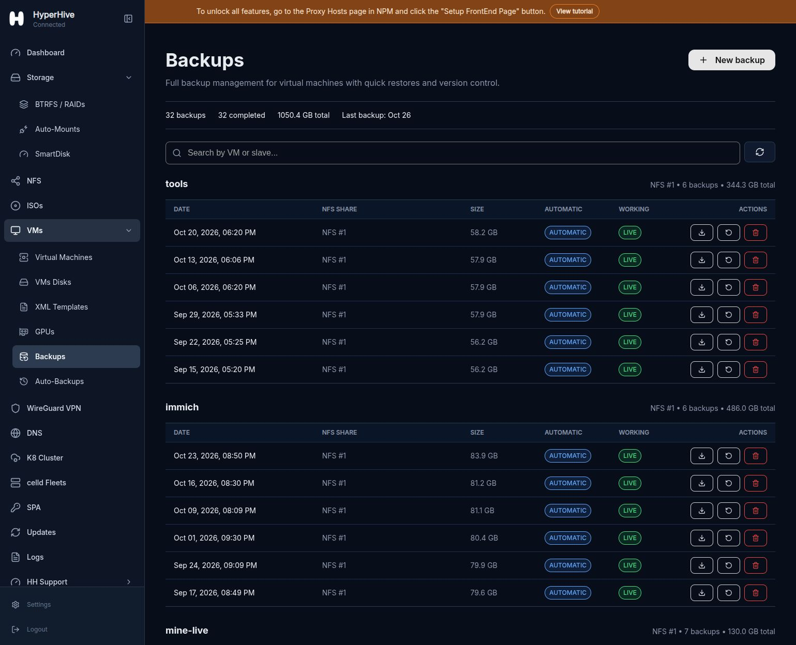

- [ ] **BK01 · P1 · S · Observed — Name restore and delete actions by backup**

  Icon-only actions are unnamed in the observed tree. Include VM and backup date in accessible names, and provide tooltips with Restore, Download and Delete.

- [ ] **BK02 · P2 · M · Observed — Use meaningful storage and backup-state names**

  Replace NFS #1 with its share name where known. Clarify Working / Live versus completed backup status after checking the underlying field semantics.

- [ ] **BK03 · P2 · M · Optional — Add sorting, filters and collapsible VM groups**

  Keep the approved table layout; add latest-first sorting controls, date/status filters and group collapse for long backup histories.

## Automatic backups — /autobackups

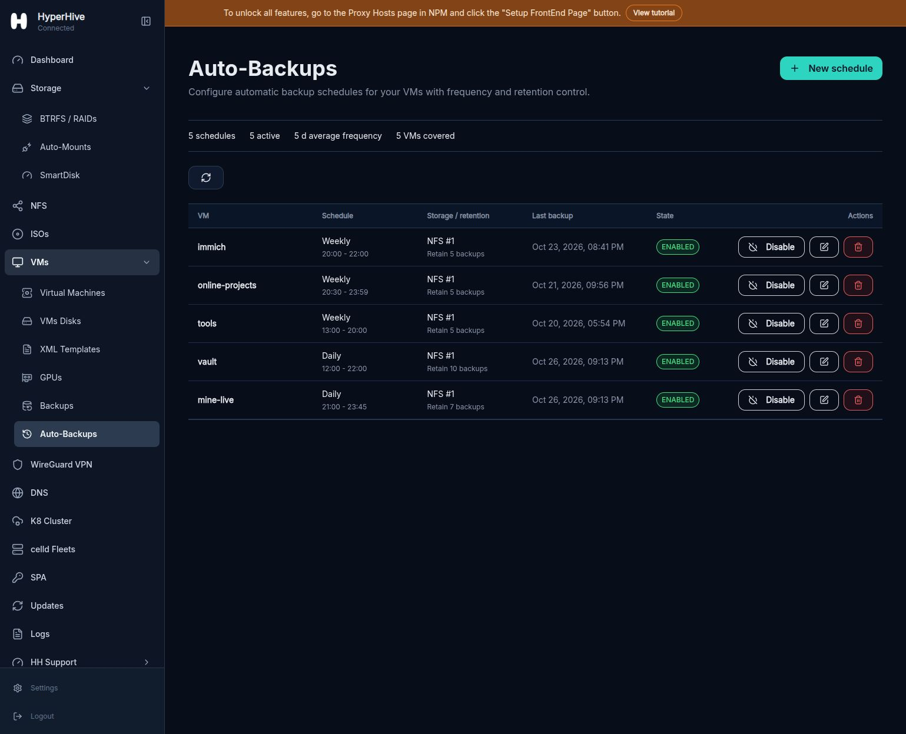

Next-run accuracy depends on scheduler semantics; this needs verification before implementation.

- [ ] **AB01 · P2 · M · Observed — Replace average frequency with next-run information**

  5 d average frequency mixes daily and weekly schedules without helping the operator. Show the next scheduled window per VM and the applicable timezone.

- [ ] **AB02 · P2 · S · Observed — Keep schedule identity and storage explicit**

  Show weekly day, actual NFS share name, retention and last result. Keep the existing aligned rows and neutral borders.

## WireGuard VPN — /wireguard

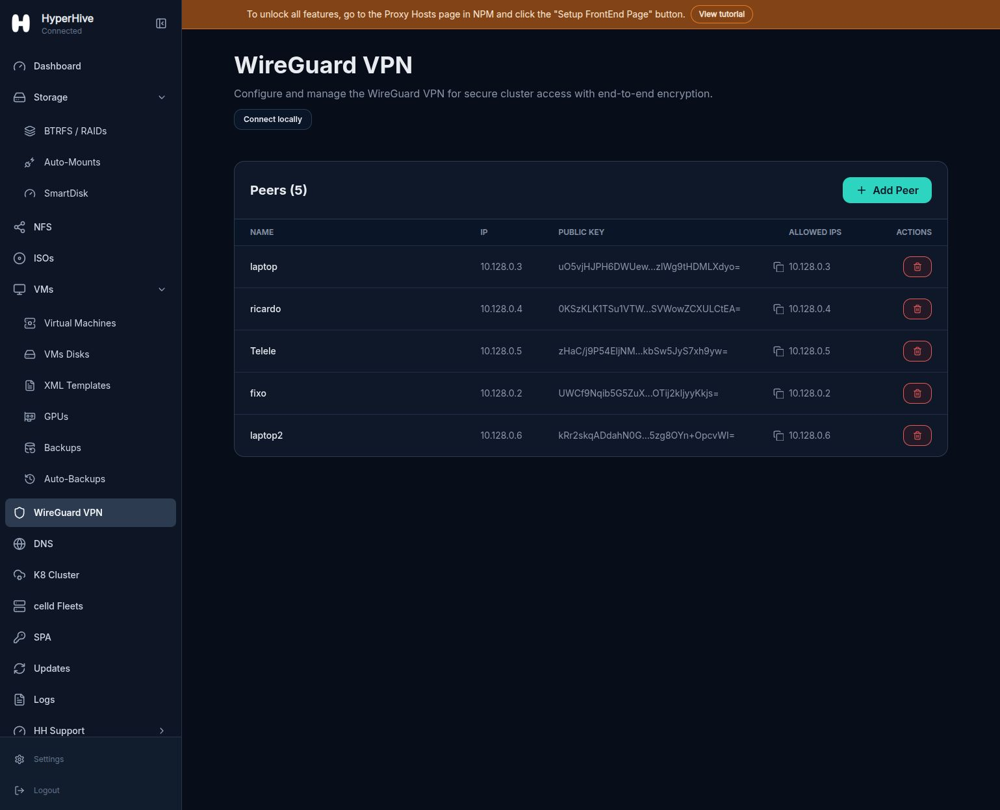

- [ ] **WG01 · P2 · M · Optional — Prioritize peer connection information**

  Offer search and, if the API provides them, latest handshake and traffic. Move full public keys into a copy/disclosure control so peer identity stays prominent.

- [ ] **WG02 · P1 · S · Observed — Label copy and remove controls**

  Use Copy public key for [peer] and Remove [peer] labels. Explain what Connect locally does before it starts a local connection workflow.

## DNS — /dns

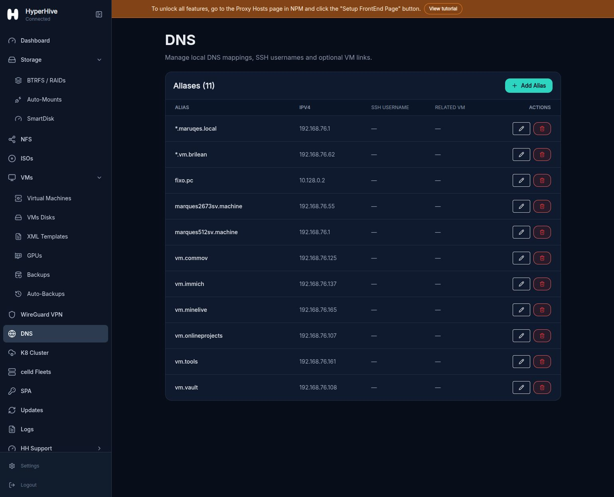

- [ ] **DN01 · P2 · M · Optional — Add alias search and sorting**

  Filter by alias, address and VM; keep the row layout and allow copying addresses.

- [ ] **DN02 · P2 · S · Observed — Make optional metadata lighter**

  Two mostly empty columns consume space. Offer compact default rows with SSH username and VM relationship in details, retaining editable values.

## Kubernetes cluster — /k8s-cluster

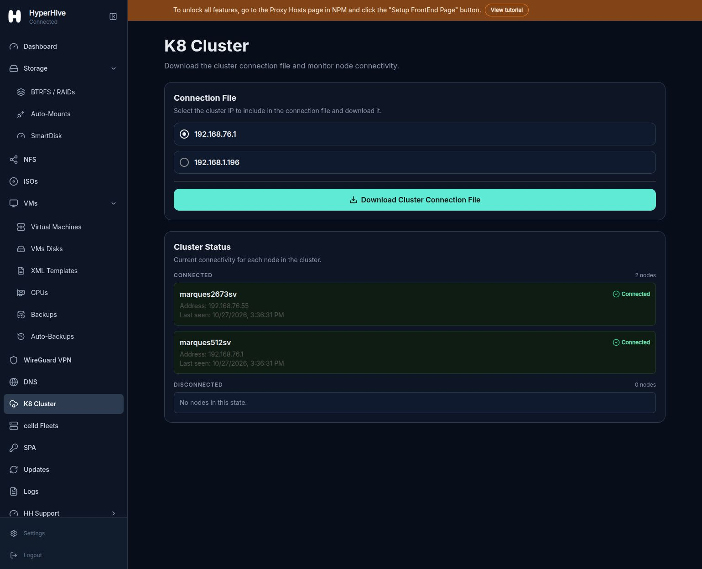

- [ ] **K801 · P2 · S · Observed — Explain the connection address choice**

  Show which interface or network each address belongs to when available and explain where the downloaded connection file will be usable.

- [ ] **K802 · P2 · S · Observed — Prioritize node state above download setup**

  Put node status first and keep the connection-file action compact. Avoid allocating a full section to an empty disconnected group.

## celld Fleets — /celld-fleet

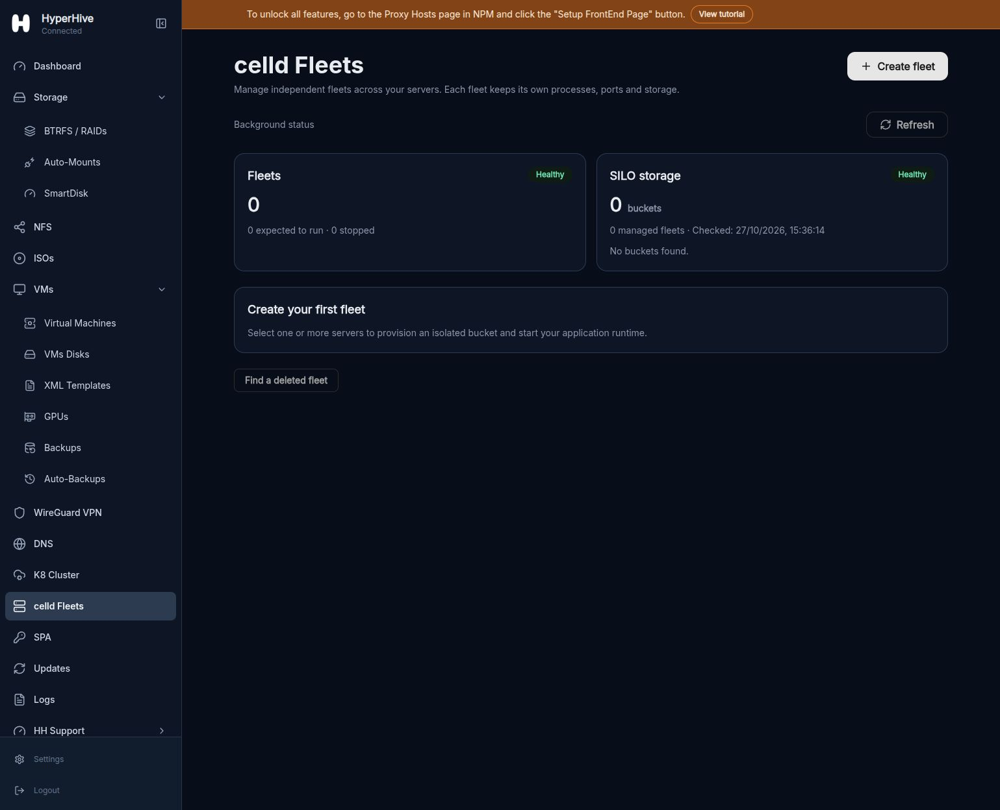

- [ ] **CF01 · P2 · S · Observed — Separate no resources from healthy resources**

  Healthy beside zero fleets/buckets can be read as a workload verdict. Label service reachability separately and show No fleets / No buckets as inventory state.

- [ ] **CF02 · P2 · S · Observed — Make the empty state actionable**

  Place Create fleet in the empty-state panel as well as the header, and explain SILO in plain language. Move deleted-fleet recovery to a secondary menu.

## Single Packet Authorization — /spa

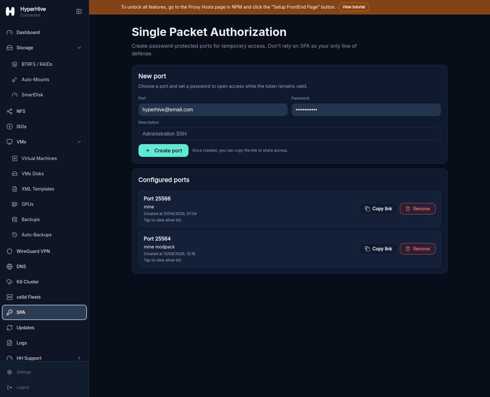

Screenshot captures initial loading and browser autofill, not a configured-port result. No port was created.

- [ ] **SP01 · P1 · M · Observed — Fix browser autofill and port input semantics**

  The browser filled the Port field with an account email on navigation. Use an explicitly labeled numeric port input and appropriate autocomplete semantics; verify password-manager behavior without submitting a port.

- [ ] **SP02 · P2 · M · Optional — Make access scope and duration explicit**

  Explain what access is opened, how long it lasts and how it is revoked before Create port. Show actual configured behavior; do not invent an expiry field unsupported by the backend.

## Updates — /updates

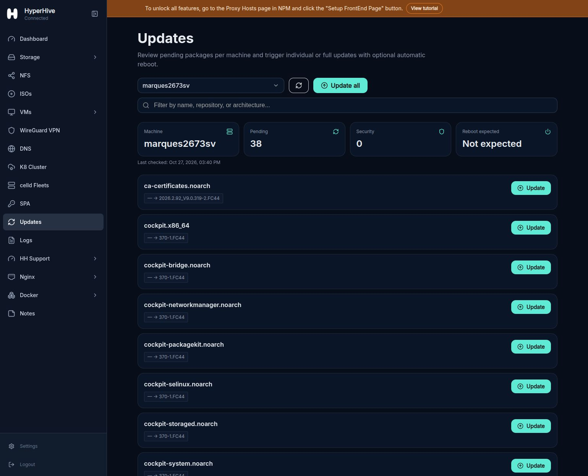

- [ ] **UP01 · P1 · M · Verify first — Show update impact before applying**

  Review the existing confirmation flow for host, package count, automatic reboot and expected interruption. Add missing impact information only after inspecting the current confirmation.

- [ ] **UP03 · P2 · M · Optional — Use compact package rows**

  Thirty-eight updates each occupy a large card. Use aligned package, installed version, available version and action columns; explain unknown installed versions instead of a bare arrow.

- [ ] **UP02 · P2 · S · Observed — Make refresh and pending availability explicit**

  Name the refresh control and distinguish checking from no pending packages. Preserve the existing Last checked timestamp and keep automatic interval labels hidden.

## Logs — /logs

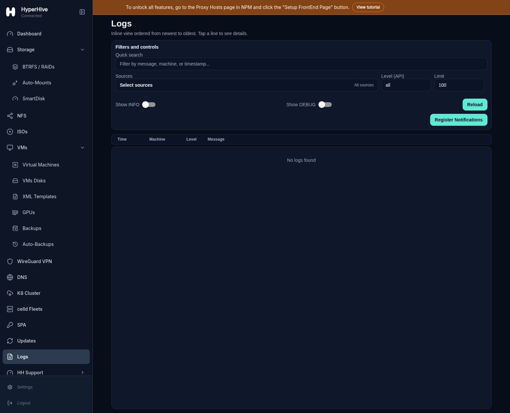

- [ ] **LG01 · P1 · M · Observed — Use semantic controls for filtering and reloading**

  Reload, Select sources and Register Notifications appear as text/containers in the observed tree. Make them keyboard-operable buttons/selects with proper names and state.

- [ ] **LG02 · P2 · M · Observed — Simplify the filter model**

  Level (API) overlaps INFO/DEBUG switches and accepts arbitrary text. Offer one understandable severity model, with advanced source/limit controls in a disclosure.

- [ ] **LG03 · P2 · M · Optional — Give empty results a recovery path**

  Differentiate loading, no matching logs, no collected logs and failed query. Offer Clear filters or Retry as applicable and put notification setup in secondary actions.

## HH Support — /support

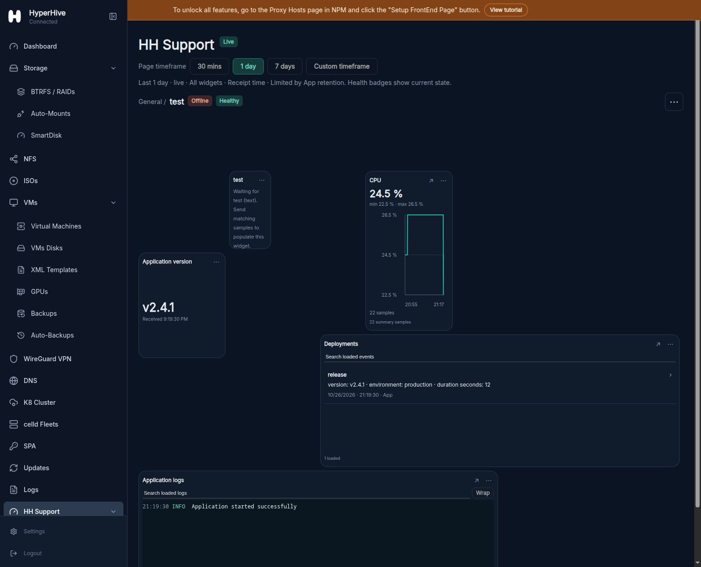

The displayed layout is user-configurable; sparse placement may be intentional. Proposals must preserve existing layouts unless explicitly reset.

- [ ] **SU01 · P1 · M · Observed — Prevent widgets shrinking below usable sizes**

  The saved layout shows a very narrow text widget and a narrow CPU chart surrounded by gaps. Enforce minimum usable widget dimensions and provide a deliberate Fit layout action without silently overwriting saved positions.

- [ ] **SU02 · P2 · M · Observed — Explain Live, Offline and Healthy separately**

  The screen shows all three at once. Label connection to telemetry service, App heartbeat and last evaluated health as distinct signals with timestamps.

- [ ] **SU03 · P2 · M · Optional — Offer alignment and layout recovery tools**

  Add Snap to grid / Align / Reset layout in edit mode, preserving the free placement model. Any reset must preview its effect and preserve a recovery path.

- [ ] **SU04 · P2 · S · Observed — Make empty widgets concise and useful**

  The narrow waiting widget wraps a long paragraph word by word. Use a short no-data message with expected stream name and a details disclosure.

## 404 hosts — /404

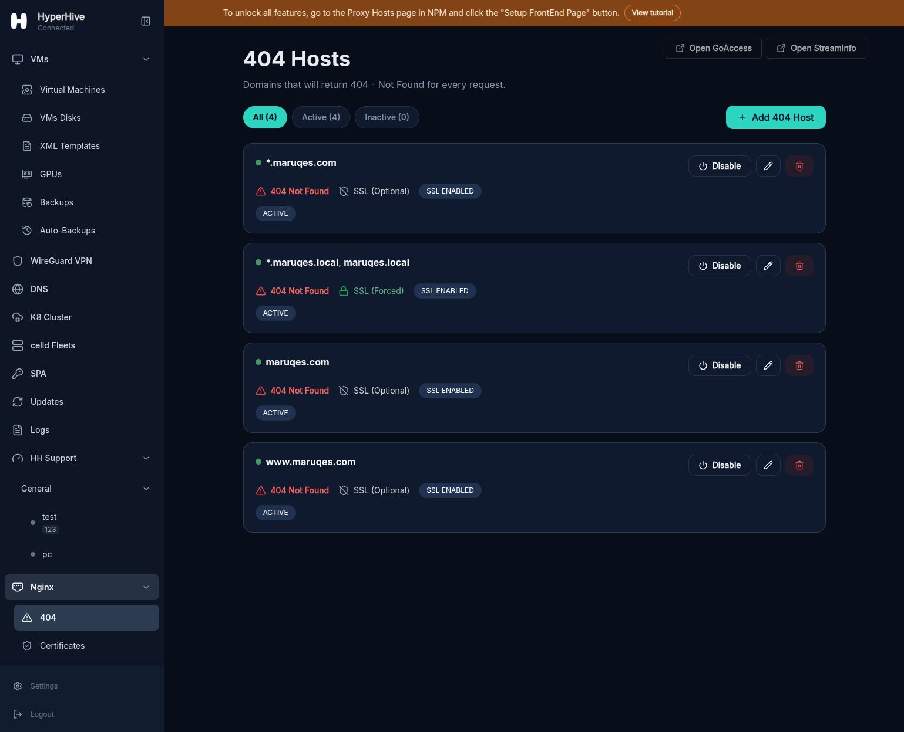

- [ ] **N401 · P2 · S · Observed — Present intentional 404 behavior without alarm styling**

  Every correctly configured rule shows a red warning-style 404 Not Found. Use a neutral Returns 404 behavior label; reserve red for actual failures.

- [ ] **N402 · P2 · M · Optional — Use compact domain rules**

  Offer rows with domain, TLS policy, enabled state and actions. Remove repeated ACTIVE / SSL ENABLED chips when the same information is already expressed.

## Certificates — /certificates

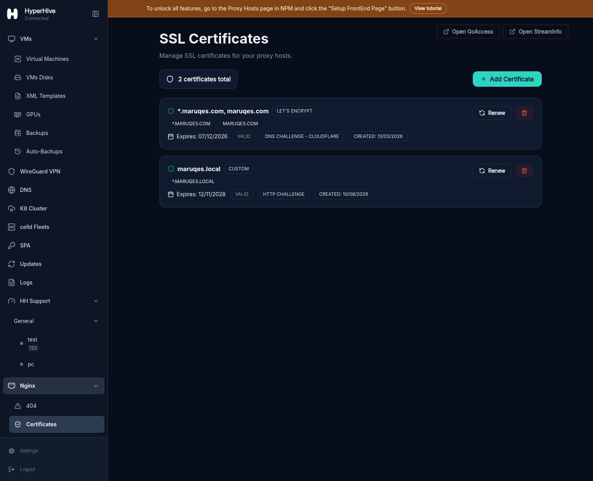

- [ ] **CE01 · P2 · M · Optional — Make expiry actionable**

  Show Expires in [days] beside an unambiguous date, with expiry sorting and due-soon filtering. Reuse existing certificate data.

- [ ] **CE02 · P2 · S · Verify first — Match certificate actions to provider capabilities**

  The custom certificate also shows Renew. Verify what that action does and use Replace or Renew according to the actual supported operation.

## Access lists — /access-lists

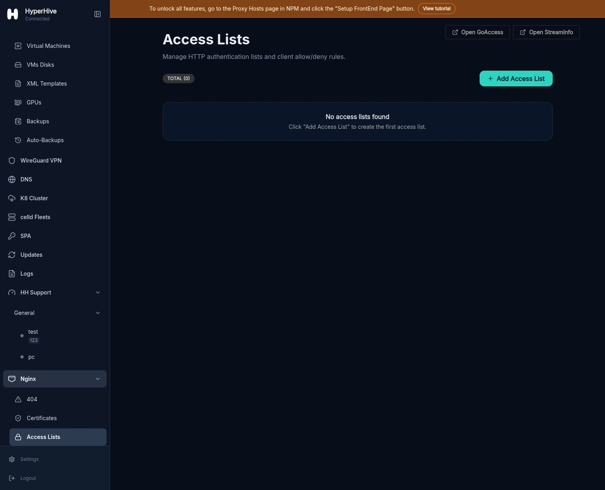

Only the empty inventory was inspected; the second item is a proposed verification task, not a confirmed bug.

- [ ] **AL01 · P2 · S · Optional — Explain the two kinds of access rules in the empty state**

  Offer concise guidance on HTTP authentication versus client allow/deny rules, then one Create access list action.

- [ ] **AL02 · P2 · M · Verify first — Show policy effects in create/edit review**

  Before save, summarize allow/deny ordering, authentication combination and affected proxies. No populated list or save flow was tested in this audit.

## Proxy hosts — /proxy

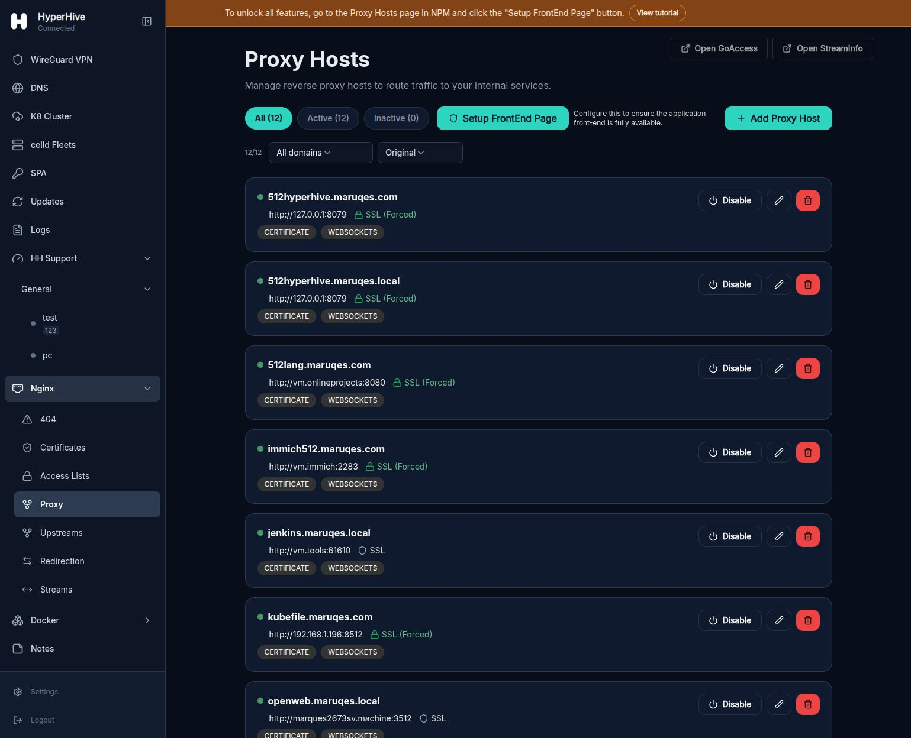

- [ ] **PX01 · P2 · M · Observed — Separate setup from everyday proxy management**

  Setup FrontEnd Page competes with Add Proxy Host in the same toolbar. Put setup status in a compact distinct notice, preserving its existing operation.

- [ ] **PX02 · P2 · M · Optional — Offer searchable compact proxy rows**

  Add free-text search alongside domain grouping, and align domain, destination, TLS and enabled state. Keep operational actions available.

- [ ] **PX03 · P1 · S · Observed — Reduce the visual dominance of delete**

  Bright filled red Delete appears on every proxy. Use a quiet danger affordance or labeled menu and retain resource-specific confirmation.

## Upstreams — /upstreams

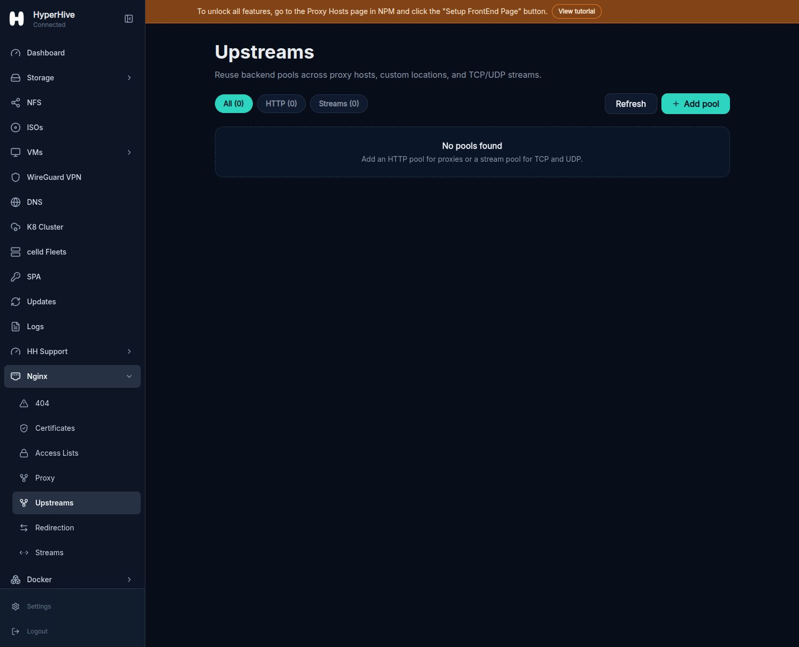

- [ ] **US01 · P2 · S · Optional — Offer purpose-specific empty-state actions**

  Give Create HTTP pool and Create TCP/UDP pool choices with a brief consumer explanation, instead of requiring an extra type decision after Add pool.

- [ ] **US02 · P2 · M · Verify first — Show usage and capability restrictions on populated pools**

  Review whether pools show consumers and supported backend capabilities before editing/removal. Empty inventory prevents visual verification of that state.

## Redirections — /redirection

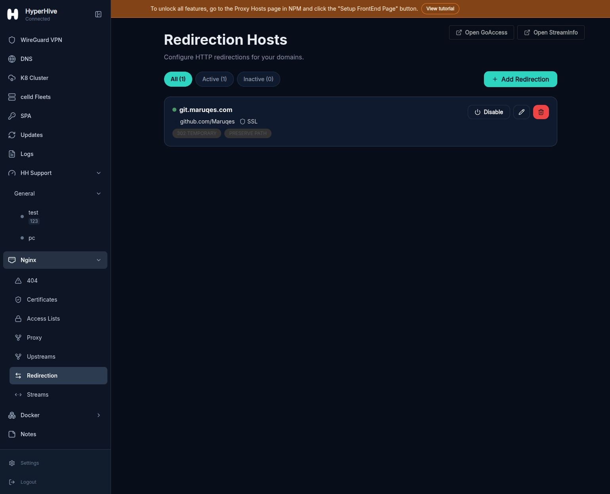

- [ ] **RD01 · P1 · S · Observed — Make redirect behavior readable**

  The 302 TEMPORARY and PRESERVE PATH chips are faint. Show clear normal-text labels for code, path behavior and destination.

- [ ] **RD02 · P2 · S · Optional — Show source-to-destination mapping directly**

  Use Domain → destination, with copy/open controls and an explicit protocol. Preserve configured destinations exactly.

## TCP/UDP streams — /streams

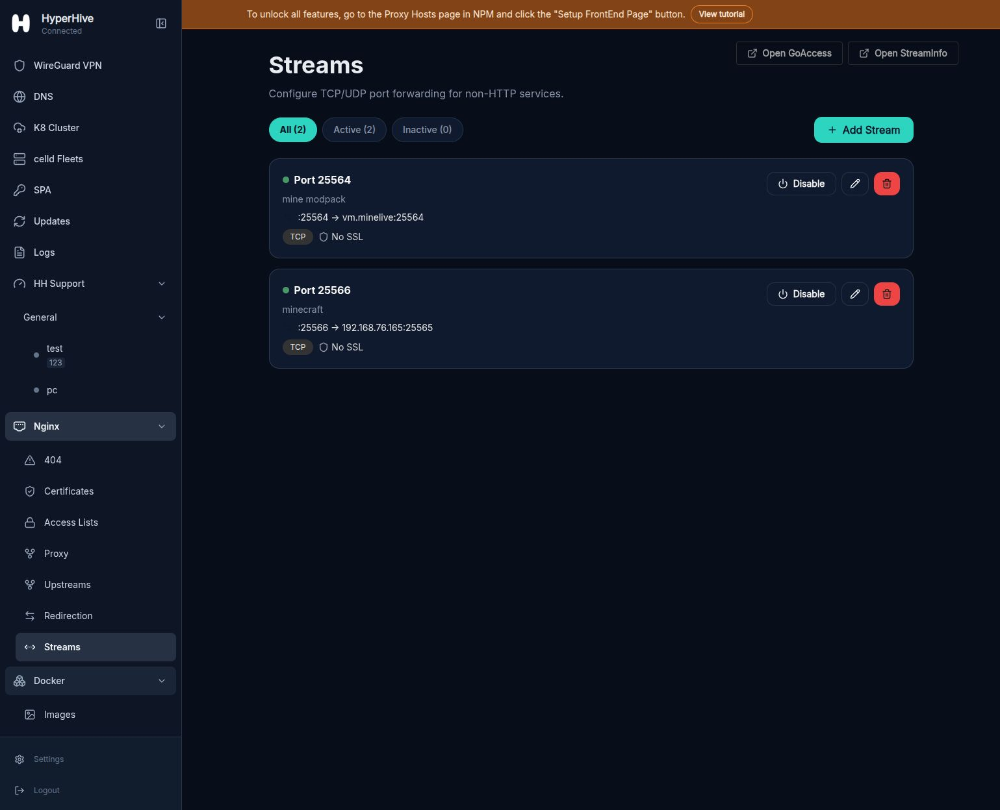

- [ ] **TS01 · P2 · S · Optional — Align listener and destination fields**

  Use rows with listener port, target host/port, TCP/UDP, TLS and enabled state. Keep description visible and technical values copyable.

- [ ] **TS02 · P2 · S · Observed — Use protocol-appropriate security copy**

  For a TCP stream, No SSL is informational. Show TLS off neutrally; explain exposure in details instead of implying all non-HTTP streams require HTTPS.

## Docker images — /docker/images

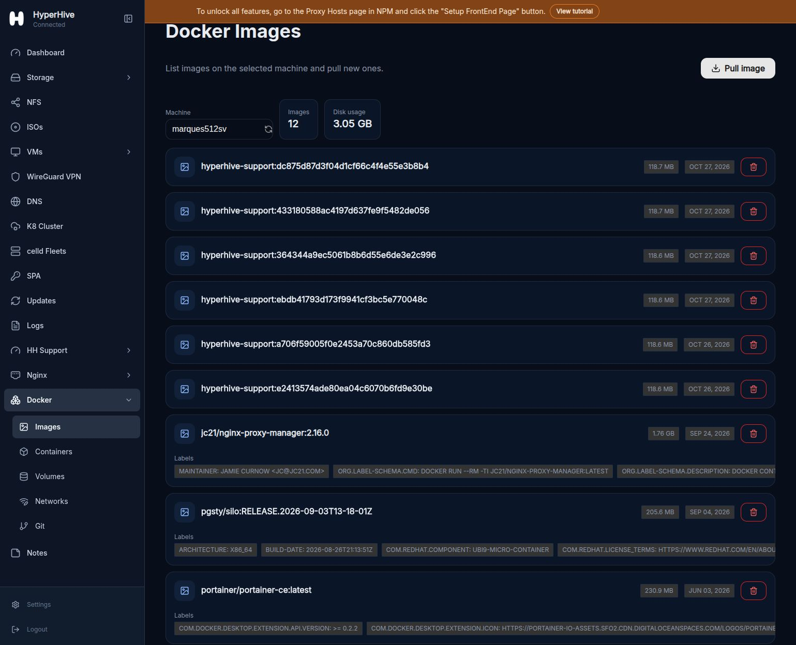

- [ ] **DI01 · P1 · M · Observed — Contain overflowing image metadata**

  Long label chips run beyond the content area. Show label count and expand to a wrapping key/value table with full-value copy; preserve case and exact strings.

- [ ] **DI02 · P2 · M · Optional — Add image search and usage context**

  Filter by repository/tag and show in-use references when available. Separate tag and digest so long hashes do not dominate identity; do not offer unverified cleanup savings.

## Docker containers — /docker/containers

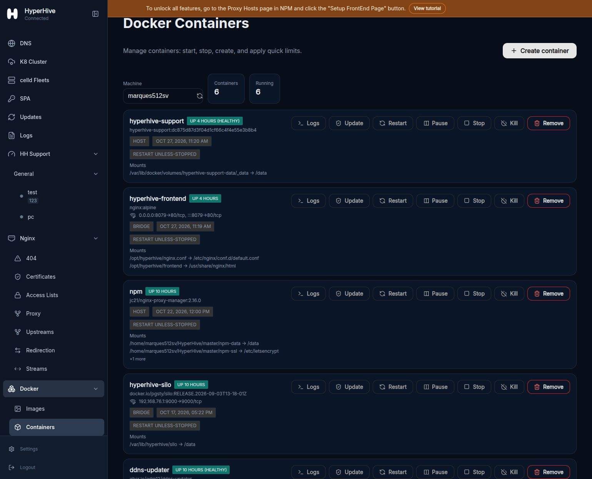

- [ ] **DC01 · P1 · M · Observed — Separate routine controls from forceful actions**

  Every container exposes Logs, Update, Restart, Pause, Stop, Kill and Remove together. Keep common actions visible and move Kill/Remove to a labeled danger menu with impact confirmation.

- [ ] **DC02 · P2 · M · Optional — Make container rows scannable**

  Show name, image, textual state/health and ports first; collapse mount lists and restart metadata into details. Add search and state filters.

## Docker volumes — /docker/volumes

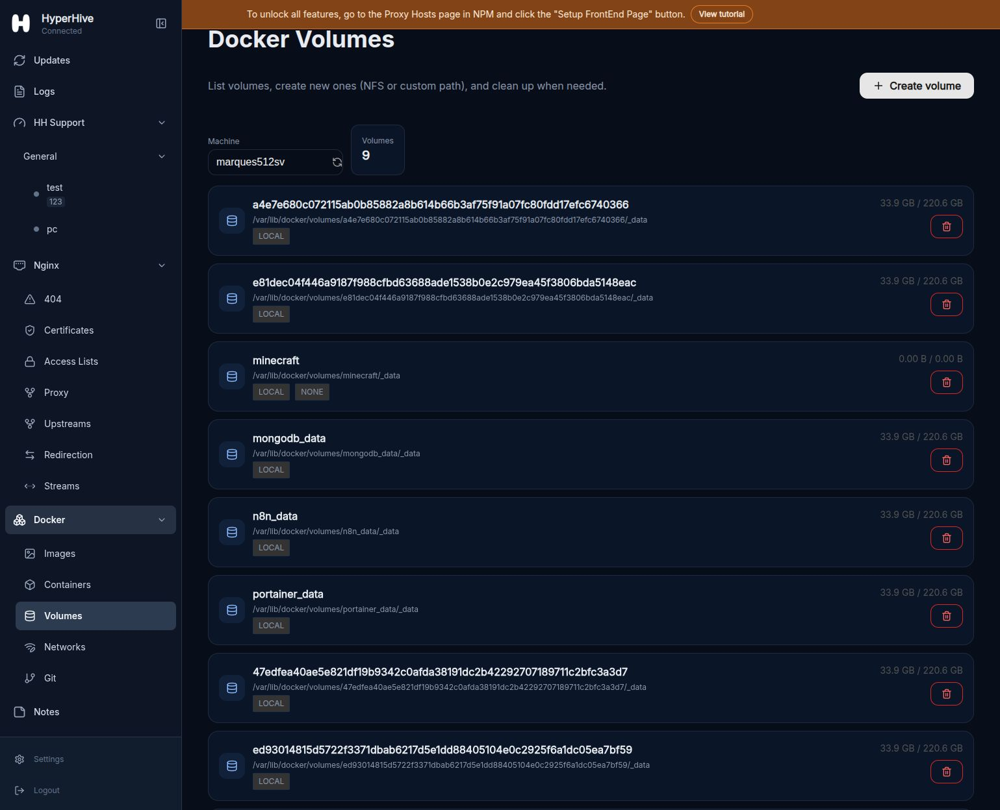

- [ ] **DV01 · P1 · M · Verify first — Disambiguate displayed capacity**

  Multiple different volumes show the same 33.9 GB / 220.6 GB pair. Verify whether this is backing-filesystem usage, then label it accordingly instead of implying per-volume size.

- [ ] **DV02 · P2 · M · Optional — Prioritize volume identity and consumers**

  Shorten anonymous hashes visually with full copy/disclosure and show attached containers when available. Distinguish an unused volume only when reference data supports it.

## Docker networks — /docker/networks

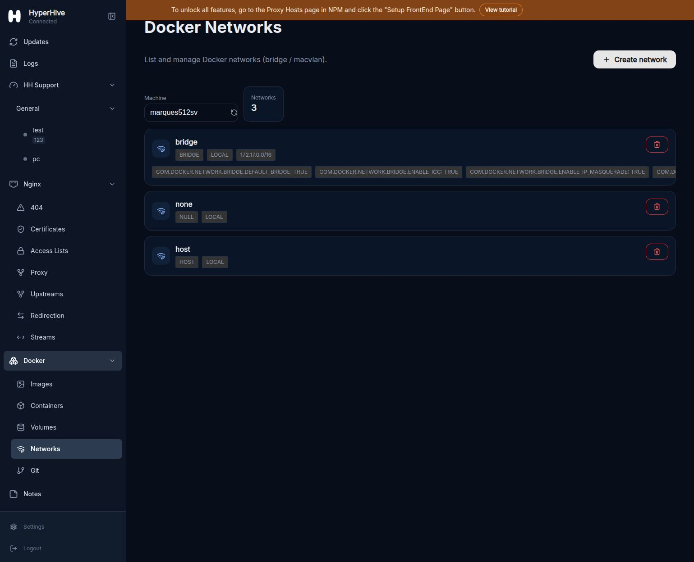

- [ ] **DW01 · P2 · S · Observed — Collapse verbose network driver options**

  Keep network, driver, subnet and scope prominent. Expand full options as a key/value table without uppercasing technical values.

- [ ] **DW02 · P1 · M · Verify first — Explain built-in and in-use deletion restrictions**

  Built-in bridge/host/none networks display remove controls. Verify server restrictions and disable or explain unavailable actions, retaining backend validation.

## Docker Git — /docker/git

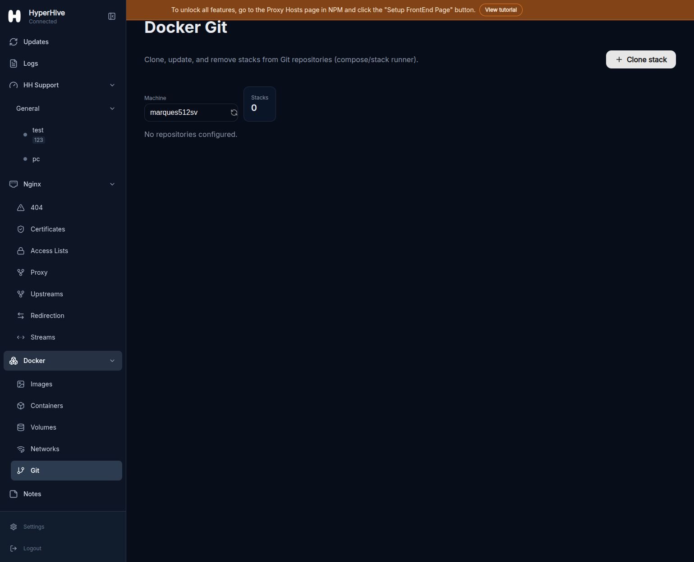

- [ ] **GT01 · P2 · S · Observed — Give the empty state a clear next step**

  Replace plain No repositories configured with a compact explanation and Clone stack action, including accepted repository/compose expectations.

- [ ] **GT02 · P2 · M · Verify first — Review deployment state presentation**

  For populated stacks, check branch/ref, last result, update progress and error recovery. The current host has no repositories, so no such defect is claimed.

## Notes — /notes

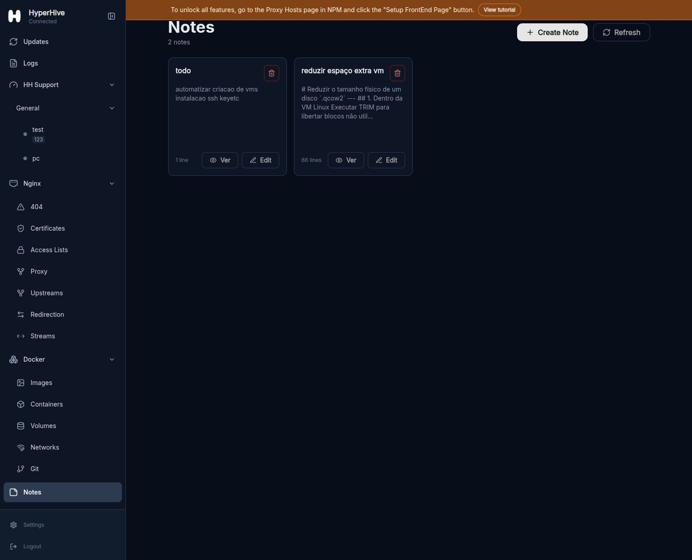

- [ ] **NT01 · P2 · S · Observed — Use consistent interface language**

  Rename Ver to View. Preserve user-authored Portuguese note titles and content exactly.

- [ ] **NT02 · P2 · M · Observed — Make note previews more useful**

  Render a readable markdown excerpt rather than raw markdown markers, reduce forced empty card height, and provide search as notes grow.

## Settings — Settings dialog

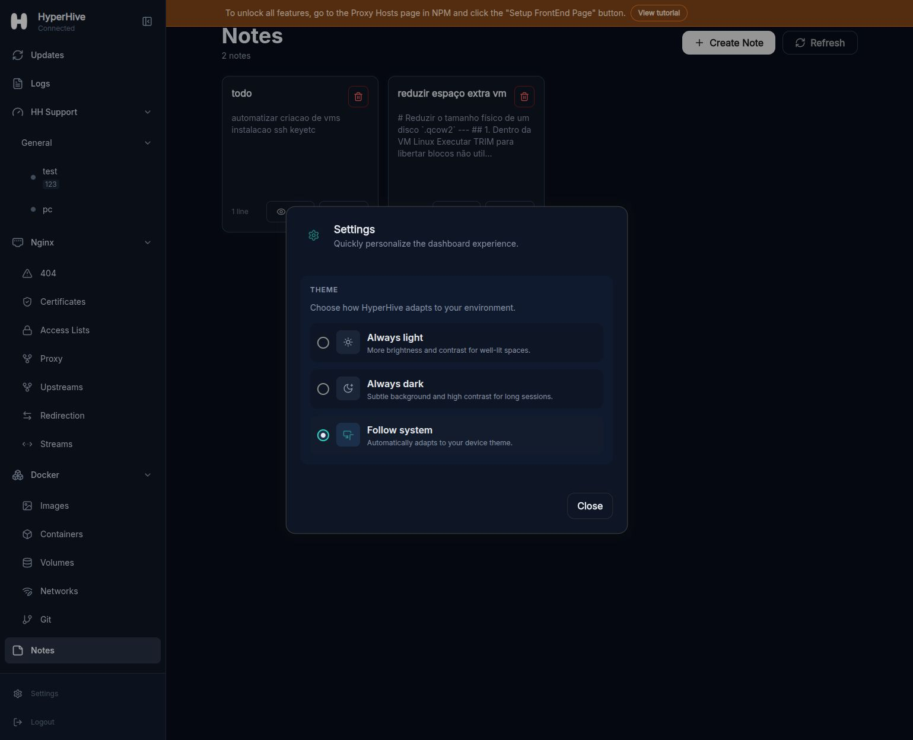

No theme preference was changed. Light appearance was not validated.

- [ ] **SE01 · P1 · S · Observed — Name the close icon and theme options clearly**

  The top close button has no accessible name and radio descriptions are light/dark/system. Use Close settings and the visible human-readable option labels.

- [ ] **SE02 · P3 · S · Optional — Make the settings dialog proportional to its content**

  The dialog contains only theme preferences but uses a large shell. Use a compact layout while retaining readable descriptions and the explicit Close action.